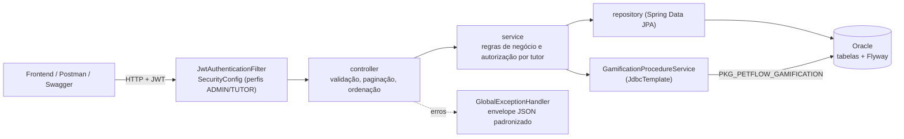

# 🐾 PetFlow API

[](https://adoptium.net/)
[](https://spring.io/projects/spring-boot)
[](https://www.oracle.com/database/)
[](https://swagger.io/)
[](https://flywaydb.org/)

## 📋 Sumário

- [Sobre o Projeto](#sobre-o-projeto)
- [Equipe](#equipe)
- [Tecnologias Utilizadas](#tecnologias-utilizadas)
- [Arquitetura do Projeto](#arquitetura-do-projeto)
- [Java Advanced](#java-advanced)
- [Visão de Domínio](#visão-de-domínio)
- [Endpoints da API](#endpoints-da-api)
- [Banco de Dados](#banco-de-dados)
- [JSON e MongoDB](#json-e-mongodb)
- [Swagger / OpenAPI](#swagger--openapi)
- [Como Executar](#como-executar)
- [Testes](#testes)
- [Links](#links)

---

## 📌 Sobre o Projeto

O **PetFlow** é uma aplicação web completa desenvolvida em Java com Spring Boot para gerenciamento de saúde preventiva pet. A solução gamifica o cuidado com o pet: eventos de saúde concluídos geram pontos para o tutor, que podem ser trocados por cupons de desconto em clínicas parceiras.

A API suporta perfis ADMIN e TUTOR com JWT, persistência Oracle via JPA, evolução de schema pelo Flyway e documentação interativa OpenAPI. O frontend é mantido em outro repositório.

---

## Equipe

| Nome | RM |
|---|---:|
| Lucas Grillo Alcântara | 561413 |
| Pietro Ferreira Gomes Abrahamian | 561469 |
| Pedro Peres Benitez | 561792 |
| Lucca Ramos Mussumecci | 562027 |

**Turma:** 2TDSPX

---

## Tecnologias Utilizadas

- **Java 21**: records para contratos imutáveis e suporte a versões LTS atuais.
- **Spring Boot 4.0.6**: composição de API, segurança, validação e integração de dados.
- **Spring MVC + Validation**: endpoints REST e validação declarativa nos DTOs.
- **Spring Data JPA**: consultas paginadas e relacionamentos do domínio Oracle.
- **Spring JDBC**: chamadas explícitas a procedures PL/SQL para pontos e resgates atômicos.
- **Spring Security + java-jwt**: autenticação stateless e autorização por perfil.
- **Oracle Database + Flyway**: persistência relacional e histórico versionado de migrações.
- **Spring Cache**: cache apenas onde não pode contornar a autorização por tutor (chaves incluem paginação e ordenação).
- **Spring Boot Actuator**: `GET /actuator/health` (liveness/readiness e conexão com o Oracle) para monitoramento.
- **JUnit 5 + Mockito + MockMvc + JaCoCo**: testes unitários, de controller com segurança JWT real e relatório de cobertura.
- **Lombok**: redução de boilerplate em entidades e serviços, sem substituir records nos DTOs.
- **springdoc OpenAPI**: documentação navegável dos endpoints reais.
- **Maven Wrapper**: builds reproduzíveis sem exigir Maven global.

---

## Arquitetura do Projeto

Arquitetura em camadas com dependências sempre apontando para dentro (controller → service → repository), DTOs `record` na borda HTTP e regras transacionais críticas no Oracle (package PL/SQL).



```text
src/main/java/br/com/petflow/petflow_api/
├── config/          # Segurança, cache, agendamento e Swagger
├── controller/      # Endpoints REST (paginação/filtros/ordenação)
├── dto/             # Records de entrada e saída
├── entity/          # Entidades JPA
├── enums/           # Enumeradores e EnumParser
├── exception/       # Exceções de negócio e handler global
├── repository/      # Repositórios Spring Data (projeções DTO)
├── security/        # JWT: serviço, filtro e handlers 401/403
└── service/         # Regras de negócio e chamadas às procedures
```

Decisões: injeção por construtor (`@RequiredArgsConstructor`), transações no service, autorização por dono do recurso (`SecurityUtils.checkOwnership`), ordenação restrita a campos permitidos (`ApiPageable`) e erros sempre em JSON.

---

## Java Advanced

O domínio mostra conceitos Java em contexto: records imutáveis para contratos de entrada/saída, enums para estados, camadas com injeção por construtor, validação declarativa, exceções de negócio com envelope JSON consistente, transações Spring e concorrência segura no resgate por PL/SQL.

O tutor cadastra pets, registra eventos concluídos, consulta saldo/histórico e resgata cupons. O ADMIN mantém clínicas, planos, cupons e tutores. A API não contém a interface; fluxos completos com UI dependem do frontend vinculado em [Links](#links).

---

## Visão de Domínio

### 👤 Tutores
Gerencia os responsáveis pelos pets, com autenticação via e-mail e senha.

### 🐾 Pets
Armazena os dados principais dos animais cadastrados e seu vínculo com o tutor.

### 🏥 Clínicas
Representa as clínicas veterinárias parceiras do sistema.

### 📄 Planos
Controla os planos de saúde/prevenção ligados às clínicas.

### 📅 Assinaturas
Registra a contratação de planos por pets.

### ❤️ Eventos de Saúde
Armazena o histórico clínico e preventivo dos pets.

### 🎟️ Cupons
Gerencia cupons emitidos para resgate.

### 🎫 Resgates
Registra o uso de cupons pelos tutores.

## 🎮 Gamificação

O PetFlow possui um sistema de gamificação onde tutores acumulam pontos ao realizar ações como cadastrar pets, registrar eventos de saúde e assinar planos. Esses pontos podem ser trocados por cupons de desconto em clínicas parceiras.

---

## Endpoints da API

> **Nota:** A documentação completa com exemplos de requisição e resposta está disponível via Swagger.

### 👤 Tutores

| Método | Endpoint | Descrição | Permissão |
|--------|----------|-----------|-----------|
| POST | `/tutors` | Cadastrar novo tutor | Público |
| GET | `/tutors` | Listar tutores | ADMIN |
| GET | `/tutors/{id}` | Buscar tutor por ID | ADMIN |
| PUT | `/tutors/{id}` | Atualizar tutor | ADMIN |
| DELETE | `/tutors/{id}` | Remover tutor | ADMIN |

### 🔐 Autenticação

| Método | Endpoint | Descrição | Permissão |
|--------|----------|-----------|-----------|
| POST | `/auth/login` | Login e geração de token JWT | Público |

### 🐾 Pets

| Método | Endpoint | Descrição | Permissão |
|--------|----------|-----------|-----------|
| POST | `/pets` | Cadastrar pet | Authenticated |
| GET | `/pets` | Listar pets (com filtros) | Authenticated |
| GET | `/pets/{id}` | Buscar pet por ID | Authenticated |
| PUT | `/pets/{id}` | Atualizar pet | Authenticated |
| DELETE | `/pets/{id}` | Remover pet | Authenticated |

### 🏥 Clínicas

| Método | Endpoint | Descrição | Permissão |
|--------|----------|-----------|-----------|
| POST | `/clinics` | Cadastrar clínica | ADMIN |
| GET | `/clinics` | Listar clínicas | Authenticated |
| GET | `/clinics/{id}` | Buscar clínica por ID | Authenticated |
| PUT | `/clinics/{id}` | Atualizar clínica | ADMIN |
| DELETE | `/clinics/{id}` | Remover clínica | ADMIN |

### 📄 Planos

| Método | Endpoint | Descrição | Permissão |
|--------|----------|-----------|-----------|
| POST | `/plans` | Criar plano | ADMIN |
| GET | `/plans` | Listar planos | Authenticated |
| GET | `/plans/{id}` | Buscar plano por ID | Authenticated |
| PUT | `/plans/{id}` | Atualizar plano | ADMIN |
| DELETE | `/plans/{id}` | Remover plano | ADMIN |

### 📅 Assinaturas

| Método | Endpoint | Descrição | Permissão |
|--------|----------|-----------|-----------|
| POST | `/subscriptions` | Criar assinatura | Authenticated |
| GET | `/subscriptions` | Listar assinaturas | Authenticated |
| GET | `/subscriptions/{id}` | Buscar assinatura por ID | Authenticated |
| PUT | `/subscriptions/{id}/status` | Atualizar status | Authenticated |
| DELETE | `/subscriptions/{id}` | Remover assinatura | Authenticated |

### ❤️ Eventos de Saúde

| Método | Endpoint | Descrição | Permissão |
|--------|----------|-----------|-----------|
| POST | `/health-events` | Registrar evento | Authenticated |
| GET | `/health-events` | Listar eventos | Authenticated |
| GET | `/health-events/{id}` | Buscar evento por ID | Authenticated |
| PUT | `/health-events/{id}` | Atualizar evento | Authenticated |
| DELETE | `/health-events/{id}` | Remover evento | Authenticated |

### 🎟️ Cupons

| Método | Endpoint | Descrição | Permissão |
|--------|----------|-----------|-----------|
| POST | `/coupons` | Gerar cupom | ADMIN |
| GET | `/coupons` | Listar cupons | Authenticated |
| GET | `/coupons/{id}` | Buscar cupom por ID | Authenticated |
| PUT | `/coupons/{id}/status` | Atualizar status | ADMIN |
| DELETE | `/coupons/{id}` | Remover cupom | ADMIN |

### 🎫 Resgates

| Método | Endpoint | Descrição | Permissão |
|--------|----------|-----------|-----------|
| GET | `/redeems` | Listar resgates | Authenticated |
| GET | `/redeems/{id}` | Buscar resgate por ID | Authenticated |

### Monitoramento

| Método | Endpoint | Descrição | Permissão |
|--------|----------|-----------|-----------|
| GET | `/actuator/health` | Estado da aplicação e do banco | Público |

### Endpoints de Gamificação

| Método | Endpoint | Descrição | Permissão |
|--------|----------|-----------|-----------|
| GET | `/gamification/points` | Retorna os pontos do tutor logado e histórico | Authenticated |
| GET | `/gamification/pets/{petId}/risk` | Retorna o score de risco de um pet | Authenticated |
| GET | `/gamification/coupons/available` | Lista cupons disponíveis para resgate | Authenticated |
| POST | `/gamification/redeem` | Resgata um cupom usando pontos | Authenticated |

O resgate valida o status e a validade do cupom e compara o custo com o saldo atual do tutor. Quando os pontos são insuficientes, a API retorna HTTP 422 com o código `INSUFFICIENT_POINTS` e os valores `availablePoints` e `requiredPoints`; o cupom não é alterado. Cupons realmente expirados retornam o código `EXPIRED_COUPON`.

---

## Banco de Dados

Oracle é a fonte relacional compartilhada com o backend Java. Hibernate usa `ddl-auto=none`; o schema é controlado pelo Flyway.

### Migrações Flyway

| Arquivo | Descrição |
|---------|-----------|
| `V1__Create_Tables.sql` | Tabelas do domínio relacional, incluindo `REWARD_POINT`. |
| `V2__Seed_Data.sql` | Domínios, ações de recompensa e dados demonstrativos. |
| `V3__Create_Gamification_Package.sql` | Package `PKG_PETFLOW_GAMIFICATION` para saldo, concessão idempotente e resgate transacional. |

`GamificationProcedureService` chama `GET_TUTOR_POINTS`, `GRANT_POINTS` e `REDEEM_COUPON`. Os serviços Java mantêm autorização e composição HTTP; a procedure é a fonte da regra transacional para concessão/resgate. Não há `COMMIT` dentro do package, para a transação Spring controlar o commit/rollback. Os erros Oracle de saldo insuficiente e cupom expirado são convertidos para `INSUFFICIENT_POINTS` e `EXPIRED_COUPON` com HTTP 422.

Em um Oracle novo, o Flyway executa V1, V2 e V3. Em schema legado já populado com o estado equivalente a V1/V2 e sem histórico Flyway, o baseline configurado é V2 e a V3 é aplicada sem repetir o seed. Não use esse baseline em schema vazio ou parcial.

O relacionamento `HEALTH_EVENT`/`EVENT_TYPE` usa `EVENT_TYPE_ID`; pontos de evento vêm de `EVENT_TYPE.POINTS_REWARD`. A concessão referencia a ação `EVENTO_SAUDE_REALIZADO` no histórico.

Não foi incluído trigger de auditoria: o schema imutável desta API não contém as tabelas de auditoria exigidas pelo script externo. Os arquivos Oracle originais da disciplina não são alterados por este projeto.

## JSON e MongoDB

O diretório [`database`](database/README.md) documenta e contém uma exportação SQL*Plus/SQLcl baseada no schema efetivamente usado pela API, validadores/índices `mongosh`, os comandos `mongoimport` e um exemplo sintético. O modelo usa embedding para dados consultados juntos (pet/tutor, tipo de evento, plano/clínica e carteira) e IDs Oracle para rastreabilidade. `PASSWORD_HASH` não é exportado.

`ADDRESS` e `RISK_SCORE` não existem na V1 da API; por isso não aparecem no JSON. O score de risco atual é calculado pelo serviço Java, não armazenado como histórico relacional. Execute export/import apenas com dataset controlado; JSON real pode conter dados pessoais e de saúde e não deve ser versionado.

---

## Swagger / OpenAPI

A documentação interativa da API está disponível em:

```text
/swagger
```

---

## Como Executar

### Pré-requisitos

- JDK 21 (com `JAVA_HOME` apontando para ele)
- Git
- Oracle Database

### Configuração local

Crie o arquivo local de configuração a partir do exemplo:

```powershell
Copy-Item .env.example .env
```

Preencha `DB_URL`, `DB_USERNAME`, `DB_PASSWORD`, `JWT_SECRET` e `CORS_ALLOWED_ORIGINS`. O `.env` é ignorado pelo Git; nunca o publique. O segredo JWT deve ser aleatório e ter pelo menos 32 caracteres. `JWT_EXPIRATION_MS` é opcional e usa 86400000 ms por padrão; `PORT` é opcional e usa 8080.

O Spring Boot importa `.env` por `spring.config.import`; também é possível fornecer as mesmas variáveis diretamente no ambiente de execução/VS Code. Valores obrigatórios ausentes impedem a inicialização.

Na coleção Postman versionada, configure `tutor_email`, `tutor_password`, `admin_email`, `admin_password` e `new_tutor_password` em um environment local não compartilhado. A coleção não contém credenciais: os logins preenchem `token` e `admin_token`, as criações guardam os IDs (`pet_id`, `plan_id`...) e cada requisição tem testes de status. Execute a coleção inteira (Runner ou `newman run "PetFlow API.postman_collection.json" -e local.json`) na ordem: ela cria, consulta, atualiza e remove os próprios dados (pasta *Limpeza*).

### Iniciar

```bash
./mvnw clean verify
./mvnw spring-boot:run
```

No Windows, execute `.\mvnw.cmd` diretamente no PowerShell. A API inicia em `http://localhost:8080`; Swagger em `http://localhost:8080/swagger`. O frontend fica em outro repositório e precisa ter sua origem em `CORS_ALLOWED_ORIGINS`.

### Fluxo de demonstração

1. Cadastre um tutor por `POST /tutors` e autentique em `POST /auth/login`.
2. Com o token TUTOR, cadastre um pet e confira a concessão de pontos.
3. Registre um evento de saúde `REALIZADO`; os pontos vêm do tipo de evento configurado.
4. Crie assinatura ativa e confira o histórico de pontos.
5. Consulte cupons disponíveis e faça resgate: saldo, validade, baixa do cupom, resgate e débito são tratados pela procedure.
6. Com perfil ADMIN, confira as rotas administrativas e os logs sem dados sensíveis da chamada ao package.

### Frontend separado

O frontend usado no desenvolvimento está em [petflow-front-api-java](https://github.com/lgaxd/petflow-front-api-java). Inicie-o separadamente e configure seu endereço local (por padrão `http://localhost:5173`) em `CORS_ALLOWED_ORIGINS`.

## Testes

O build padrão não exige Oracle (testes `@Tag("integration")` ficam de fora):

```bash
./mvnw clean verify          # compila, roda os testes e gera target/site/jacoco/index.html
```

> Use JDK 21 (`JAVA_HOME` apontando para ele); com JDK mais antigo o Surefire falha ao carregar as classes.

| Camada | O que é validado |
|---|---|
| `controller/*ControllerTest` (MockMvc + segurança JWT real) | Todos os endpoints: sucesso, 400 de validação, 401 sem token, 403 por perfil, 404, 409 e 422 |
| `service/*Test` (Mockito) | Regras de negócio: transições de status, pontos, datas, propriedade do recurso, tradução dos erros da procedure |
| `service/CachingBehaviourTest` | Chaves de cache sensíveis à ordenação e invalidação em escrita |
| `security/JwtServiceTest` | Emissão, expiração, adulteração e tamanho mínimo do segredo |

Testes de integração Oracle (opcionais, gravam dados temporários):

```powershell
.\mvnw.cmd '-Dtest.excludedGroups=' '-Dtest=CouponRedemptionFlowTest,GamificationProcedureIntegrationTest' test
```

Teste de fumaça ponta a ponta contra a API rodando com o Oracle real (login, CRUD de pets/eventos/assinaturas, pontos, resgate e erros):

```bash
./mvnw spring-boot:run
python scripts/e2e_smoke.py http://localhost:8080
```

Preencha `ADMIN_EMAIL`/`ADMIN_PASSWORD` no `.env` para incluir os endpoints exclusivos de ADMIN (clínicas, planos, tutores). O fluxo de resgate de integração usa `TEST_TUTOR_EMAIL` e `TEST_TUTOR_PASSWORD` do `.env`.

## Links

- Aplicação publicada: **[preencher URL pública]**
- Vídeo final: **[preencher link do vídeo]**
- Frontend: https://github.com/lgaxd/petflow-front-api-java

## Evidências multidisciplinares

- Packages e integração Java: `src/main/resources/db/migration/V3__Create_Gamification_Package.sql` e `GamificationProcedureService`.
- Exportação Oracle e importação NoSQL: [database/README.md](database/README.md), scripts e exemplo em `database/`.
- Especificação de endpoints: Swagger em `/swagger`.
- Evidências externas de modelagem, vídeo e Azure DevOps: incluir os links na seção acima ou no material de entrega da disciplina.

---